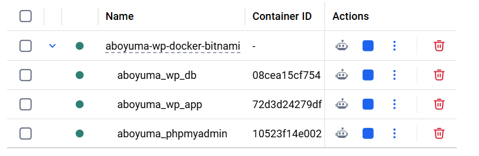
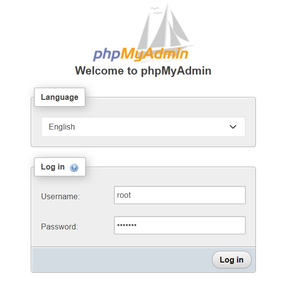
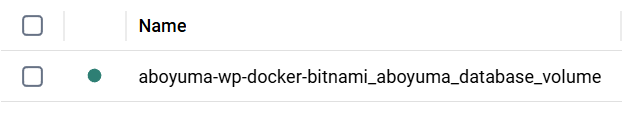
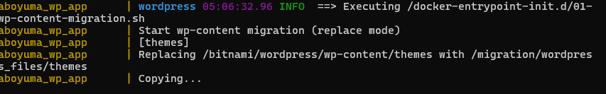
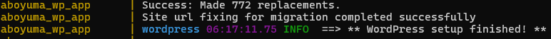

# ABO YUMA WordPress Docker Bitnami


  

**🐳 Lightweight WordPress sandbox for local plugin and theme development using Docker and the Bitnami stack.**  
The purpose of this project is to simulate a local development environment closer to the AWS Lightsail WordPress Bitnami stack.

> 📝 NOTE: This project is provided as a reference setup.  
> Please rename the project, container names, database name, and environment variables as needed to match your own setup.

References:  
https://hub.docker.com/r/bitnami/wordpress  
https://medium.com/@richardevcom/wordpress-development-environment-with-docker-ba52427bdd65

## 🧩 Project Structure

```
aboyuma/                                 # Project workspace
├── aboyuma-wordpress/                   # WordPress development workspace
│   ├── aboyuma-wp-docker-bitnami/       # Infrastructure ← This project
│   ├── wordpress/                       # WordPress content (bind-mounted)
│   └── migration/                       # WordPress migration assets
│       ├── wordpress_database/          # Database backup
│       └── wordpress_files/             # wp-content migration files
│           ├── plugins/
│           ├── themes/
│           ├── uploads/
│           └── old-site-url.txt         # Previous site URL for search-replace
└── aboyuma-content/                     # WordPress content workspace
```

ℹ️ Bitnami stores only `wp-content` and `wp-config.php` in the mounted volume;  
the WordPress core remains inside the container.

## 🧑‍💻 Plugin & Theme Development

You can develop themes and plugins inside the bind-mounted WordPress directory:
```yaml
- ../wordpress:/bitnami/wordpress
```
Clone your plugin or theme repositories into:

```
wordpress/wp-content/themes
wordpress/wp-content/plugins
```
Because the WordPress content is bind-mounted, any changes made to plugin or theme files are persisted on the host machine.  
The files will remain intact even after running `docker compose down`.

## 🚀 Run Containers

```bash
docker compose up
```

## 🌐 Access

- WordPress Site:
  [http://localhost:8080](http://localhost:8080)

- WordPress Admin Dashboard:
  [http://localhost:8080/wp-admin](http://localhost:8080/wp-admin)

- phpMyAdmin:
  [http://localhost:8081](http://localhost:8081)

## 🔐 Default Credentials

 

### Database User
- Username: db_user
- Password: db_pass

### Database Root (phpMyAdmin / full access)
- Username: root (default MariaDB superuser)
- Password: root123

## 🗄️ Database Setup

This project uses a database dump for initialization.  

MariaDB data is stored using a Docker volume:

```yaml
volumes:
  - mariadb_data:/bitnami/mariadb
```

The database is initialized on first startup when the volume is empty.  
After initialization, all data is stored inside the Docker volume and will persist across container restarts.

 

To completely reset the database, the volume must be removed:

```bash
docker compose down -v
docker compose up
```
This deletes the existing database volume and initializes a fresh database.

## 🔄 Migration Note

This project supports WordPress migration for developers moving from [XAMPP](https://www.apachefriends.org/) to Docker.  

To restore your content from a backup or mirror your production environment locally,  
place your WordPress files, including plugins, themes, and uploads, inside `../migration/wordpress_files/`

  

The progress will take some times.  

For URL fixing, please input the value in old-site-url.txt.  
This fixes issues where some images stored via `wp_options` still use the old URL and are not loaded correctly.

  

Assume your old site in XAMPP was located at `C:\xampp\htdocs\{old-site-name}`.  
Your site URL may have been `http://localhost/{old-site-name}`.

References:  
https://developer.wordpress.org/advanced-administration/security/backup  
https://wordpress.stackexchange.com/questions/269868/how-to-update-media-links-in-wordpress-after-migration
